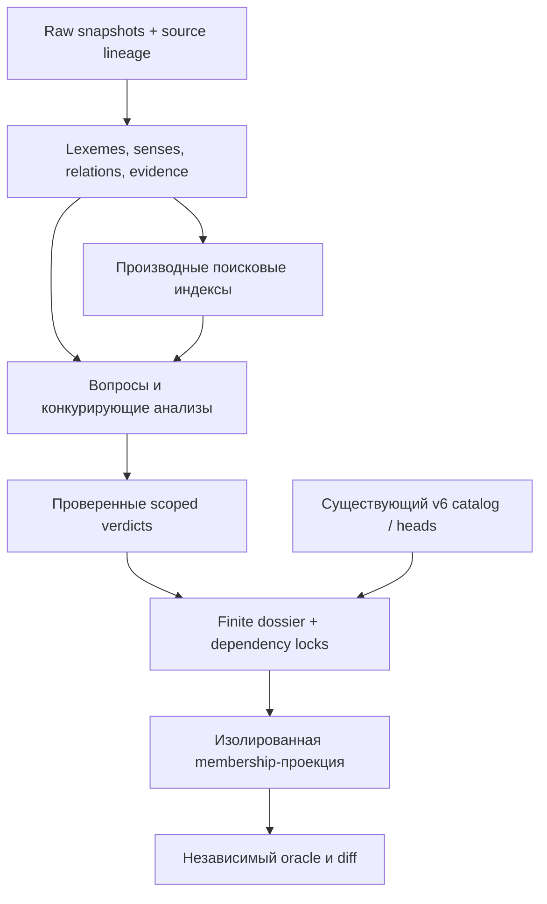

# Единая модель морфологических свидетельств — архитектурное решение

Дата: 18.10.2026. Статус: **DESIGN_ONLY**, версия спецификации `external-morphology/1.0-draft`. Документ нормативен для будущего прототипа, но не означает, что описанные новые структуры уже реализованы. В этом этапе создаются только пять Markdown-документов; код, данные семей и production не меняются.

## 1. Основания и проверенный код

Прочитаны все пять документов этапа 01 в этом каталоге: baseline, current architecture, reusable components, blockers, checkpoint. Повторный fetch не обнаружил изменения опорных refs:

| Метка | SHA | Смысл |
|---|---|---|
| M | `39d8a47d2588b55c4c750cdd9985b5d6ba26ec73` | main, действующий v5 и исправления расчётов |
| V | `9fff76431a86a06df6db69b64d7f2ca4c871f1b7` | Ветка #651 с v6; дерево совпадает с CI head `1c04d9ae48d079b56b6c37f854f96280b1915a10` |

`AGENTS.md` в этих деревьях отсутствует. V6 всё ещё не предок M; документирование интеграции не включает её merge.

Повторно проверенные точки реализации:

- M `scripts/lib/associative-family-graph.mjs::stableLemmaId`: corpus ID зависит от языка/написания, не от смысла.
- M `associativvordes/js/candidate-index-loader.js::loadCandidateEntries/annotateFamily`: после ошибки семейного источника есть retrieval fallback; M `candidate-finder.js::findCandidatesForRoot` проецирует candidate без corpus/head/proof IDs. Новый слой не использует этот путь как доказательство.
- V `associativvordes/js/associative-family-v6.js::generateV6Memberships/applyHeadReview`: exact finite scope, accepted edge, версии; это сохраняемый механизм membership.
- V `associativvordes/js/associative-family-v6-head-recognition.js::validateLexicalFacts/recognizeFiniteHeadBindings`: проверенные finite identities и явные сегментации; несколько конкурирующих facts на вопрос остаются unresolved.
- V `scripts/lib/associative-v6-senses-policy.mjs::decideLexicalRow`: лексическая строка/компонент, агрегированные частоты, блокировка несовместимых историй.
- V `scripts/lib/associative-v6-lexical-review.mjs::loadLexicalReview`, `associative-v6-family-promotion.mjs::loadFamilyPromotions`, `associative-v6-head-lifecycle.mjs::replayHeadLifecycle`: frozen grants/source hashes, dossier validation и predecessor locking. Нельзя обходить loaders вызовом materializer.
- V `associativvordes/js/associative-family-v6-shadow.js::deduplicateV6CorpusRows/loadV6ShadowRuntime`: несколько membership proofs при одном исходном измерении. Это образец будущего read-only adapter, не production-подключение.

Полная картина прежних CI и EP-01–11 — [01-BASELINE-AUDIT.md](01-BASELINE-AUDIT.md) и [BLOCKERS.md](BLOCKERS.md). Дорогие проверки и внешние импорты не повторялись.

## 2. Выбранная архитектура

**Добавить изолированный журнал внешних утверждений и решений с воспроизводимыми индексами; ссылаться на существующие v6 heads/families/memberships.** Не делать внешние данные ещё одним authoritative family registry.

На design/staging этапе из этой схемы нет пути записи в production. Даже accepted Relation означает правильность конкретного морфологического утверждения; membership требует самостоятельного разрешающего Verdict и полного finite dossier.

## 3. Границы понятий

| Понятие | Нормативное значение |
|---|---|
| Lexeme | Источниковая лексическая идентичность: lemma + language + POS/entry discriminator. Совпадение строк не объединяет разные source lexemes |
| LexemeSense | Значение этой лексемы; отсутствие sense ID — неизвестность, а не универсальное «все значения» |
| CorpusRecord | Уже существующая frequency row/lemma ID. Не новая лексема и не частота конкретного смысла |
| LexicalHead | Существующая в V языковая лексическая основа со смысловым discriminator; external stem не назначает её автоматически |
| Allomorph | Языково- и scope-зависимая реализация головы/семьи; view/sidecar существующего typed realization, не новый конкурентный каталог |
| Relation | Типизированная проверяемая пропозиция; несколько типов и направлений одной пары — разные пропозиции |
| Evidence | Утверждение конкретной записи источника и способ её интерпретации; собственное происхождение/lineage, не членство |
| Verdict | Версионированное решение по точному предмету и scope; отдельные домены evidence, relation, identity и membership |
| Family / Membership | Существующие reviewed сущности V, а не connected components внешнего графа |
| Candidate | Производная задача/предложение без прав membership; хранится в очереди, не в accepted catalog |

Схемы обязательных полей, identity keys и версий — [ENTITY-SCHEMA.md](ENTITY-SCHEMA.md). Типы отношений — [RELATION-TAXONOMY.md](RELATION-TAXONOMY.md). Приоритеты, lineage и формальная процедура membership — [EVIDENCE-AND-VERDICTS.md](EVIDENCE-AND-VERDICTS.md).

## 4. Минимальные новые инфраструктурные записи

Девять доменных сущностей не требуют девяти новых хранилищ. Добавляются только отсутствующие сущности и инфраструктура связей:

| Структура | Почему необходима | Существующее переиспользование |
|---|---|---|
| SourceRevision + RawLocator | Версия/хеш/лицензия и адрес исходной записи | Расширяет подход input locks из M `family-index-v5/manifest.json::provenance`, V builder `inputs` |
| CorpusAlignment | Bridge источниковой лексемы/смысла к старому corpus ID и конечной голове; альтернативы не теряются | После проверки экспортируется в существующие V finite bindings, не заменяет их |
| ReviewTask | Очередь по subject/scope, причины и зависимости | V `scripts/lib/associative-v6-queue-organization.mjs::organize` и packet lifecycle |
| DecisionSubject / Scope | Типизированные value objects для Verdict, не отдельная лексическая сущность | Обобщает точные ключи language/family/lemma/head/version в V |
| BuildManifest / ProjectionManifest | Замороженные inputs, policy/version, outputs и отсутствие production writes | V deterministic manifest/replay; accepted families остаются в Git |

Не создаются второй Family catalog, альтернативная система head IDs, второй генератор accepted memberships или отдельный источник частот.

## 5. Инварианты

1. Source assertion → proposed Relation; переход к подтверждённому membership всегда отдельный.
2. Автоимпорт может добавлять записи только в raw/normalized/quarantine/queue и производные indexes. Он не выпускает reviewed Verdict и не отменяет manual запреты.
3. Lineage DAG отражает зависимость фактов, а не только названия datasets. Общий/неизвестный upstream не даёт независимого голосования.
4. Значение, lexical identity, boundary/allomorph и head→family edge проверяются отдельно. Изменение одного не редактирует незаметно другое.
5. При равенстве spelling могут существовать несколько Lexeme, Sense, Relation и Evidence. Lookup normalization не используется как ID.
6. Unknown, rejected и operational error различны. Unknown direction не превращается ни в две стрелки, ни в доказанное отсутствие связи.
7. Directed paths можно перечислять для исследования, но transitive closure и union-find не доказывают membership. Каждый конечный corpus ID должен входить в reviewed scope.
8. Исторические принятые записи сохраняются как точные legacy proofs; они не сертифицируют новую голову, смысл, внешний relation или расширение scope.
9. Исходные F/IPM/N и правила выбора моделей неизменны. Повторное evidence не удваивает измерение.
10. Новый снимок публикуется атомарно только после независимой validation; старый остаётся читаемым. Публикация документации не означает публикацию data snapshot или переключение runtime.

## 6. Хранилища и воспроизводимая индексация

Следующие пути — **предлагаемые**, в этом этапе они не создаются:

| Слой | Предлагаемое место | Содержимое / правило записи |
|---|---|---|
| Raw CAS | Внешний cache/CAS, `sha256/<digest>` | Байты source archives immutable; ограниченный лицензиями доступ, отдельные retention/availability проверки |
| Git source locks | `data/morphology-evidence/sources/` | SourceRevision, license/attribution snapshots, checksums/URLs/lineage declarations; не копии гигабайтных архивов |
| Normalized CAS | `build/morphology-evidence/<build_id>/` вне tracked family trees | Сортированные partitioned NDJSON с Lexeme/Sense/Relation/Evidence; compressed chunks content-addressed |
| Quarantine | Тот же build, отдельные partitions | RawLocator, parse/validation reason, minimal preview; syntax failure не linguistic rejection |
| Индексы | `build/.../indexes/` | Производные read-only SQLite: id/ref, lookup form, relation incidence, lineage, verdict subject, queue. Не source of truth |
| Reviewed decisions | `data/morphology-evidence/reviews/` в Git | Immutable Verdict/dossier/grants; append-only логическая история. Аннотации/ограничения доступа учитывать при публикации |
| Проверенные семьи | Существующие `associativvordes/family-index-v5/` и V `family-index-v6/` в Git | Без изменений до отдельного разрешённого application stage |
| Review queues | Content-addressed build + компактный Git manifest | Воспроизводимые ReviewTask; ручные решения не теряются при пересборке очереди |

Raw может отсутствовать локально, но не должно существовать подтверждённого нового dossier, чьи обязательные raw/source proofs недоступны для проверки. Git lock содержит локаторы и хеши, а не гарантию внешней доступности: acceptance gate проверяет её отдельно. Не загружать restricted raw через public endpoint; распространять только разрешённый слой.

Будущий build: streaming parse → schema/quarantine → partition по source/language/типу → external disk sort по stable ID → merge exact duplicates без потери occurrences → lineage/ref checks → derived SQLite indexes → independent manifest validation → атомарный manifest pointer. Rows не сортируются полностью в памяти; память ограничена buffer/partition budget. Сложность сортировки порядка O(N log N) с дисковыми проходами, adjacency indexes O(N+E); lineage roots разрешаются по требованию с кешем, полное quadratic closure не материализуется.

`build_id = sha256(JCS(input_manifest + importer_versions + schema_version + mapping_policy_version + deterministic_options))`. В JCS-поле нет timestamp, machine paths или secrets. Конкурирующие builders пишут в private temp directory; публикация использует compare-and-swap по predecessor manifest. Компрессор/version, UTF-8, NFC, LF, сортировка, размеры partitions и compression options фиксируются. Byte-identical требовать для NDJSON/manifest и фиксированного compressor output; SQLite проверять по logical export/checksum индекса, не предполагать переносимую byte identity его физического файла.

Изменение одного source release пересобирает его normalized partitions и зависимые views; change impact отслеживается по точным refs/hashes. Новые Verdict переиндексируют затронутые вопросы; accepted family trees не участвуют в таком автоматическом rebuild. Resource counts/coverage — диагностика, не precision.

## 7. Совместимость и режимы

| Режим | Допустимый output | Что остаётся за границей |
|---|---|---|
| `design` | Только эти документы | Любой functional import/application |
| `ingest_shadow` (будущий) | Изолированные claims/indexes/queues | Запись heads/edges/memberships или UI wiring |
| `review_shadow` (будущий) | Проверенные verdict dossiers в отдельном Git registry | Изменение старых принятых families |
| `projection_shadow` (будущий) | Копия V snapshot + proposed finite differential вне runtime | Автоизменение production или основного v6 generated tree |
| `apply_reviewed` | В этой спецификации описан контракт, но не запускается | Требует отдельного этапа, exact grants, compatibility и независимого acceptance |

До и после любого shadow build обязательны одинаковые Git tree hashes защищённых v5/frequency/shared/runtime и существующих v6 files. M `association-analyzer.js::calculateAssociationScore/calculateFinalScore/calculateFinalAssociation`, `candidate-model-family.js::selectHighestFrequencyPerModel`, `script.js::scoringCandidates` не получают нового входа. Следовательно, новые утверждения не изменяют текущий UI, модельные группы или результаты. При будущем runtime adapter отдельно тестировать metadata и отрицательный lookup; не обходить EP-04/05.

## 8. Варианты и выбор

| Вариант | Плюсы | Проблемы | Решение |
|---|---|---|---|
| Импортировать пары прямо в v5/v6 graph | Мало промежуточных файлов | Смешивает evidence/membership, рискует ручной разметкой, теряет direction/lineage | Отклонён |
| Новый полноценный property-graph сервер как source of truth | Удобны path queries | Новая инфраструктура/миграция authoritative state, соблазн closure, второй registry | Не нужен на первом этапе; можно позже как производный query backend |
| Одна SQLite DB для всех raw/reviewed сущностей | Транзакции, индексы, простая локальная работа | Плохо обозримая Git-история решений, coupling raw и reviewed, физические snapshot diffs | SQLite выбран только для производных read-only индексов |
| **Immutable claims + Git decisions + existing v6 projections** | Разделение авторитетов, provenance/replay, finite scoped review, минимальная миграция | Требует строгих refs/manifests и garbage-collection policy | **Выбран** |

Выбор определяется уже существующими V finite review/source-lock механизмами и требованием сохранить семьи в Git. Новая модель восполняет external evidence слой, не переписывает готовую head architecture. Последовательность реализации и проверяемые gates — [IMPLEMENTATION-PLAN.md](IMPLEMENTATION-PLAN.md).
