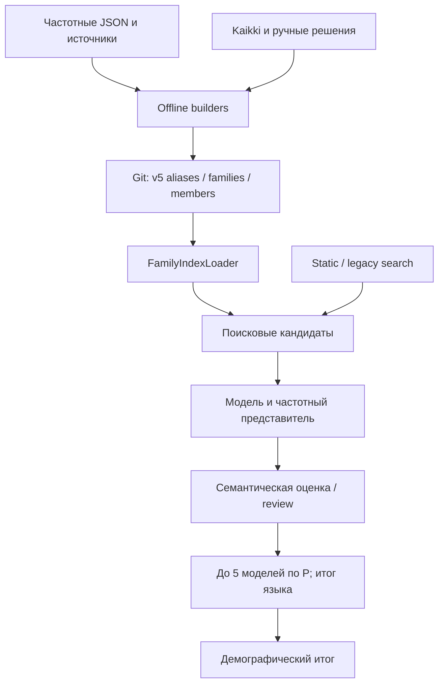
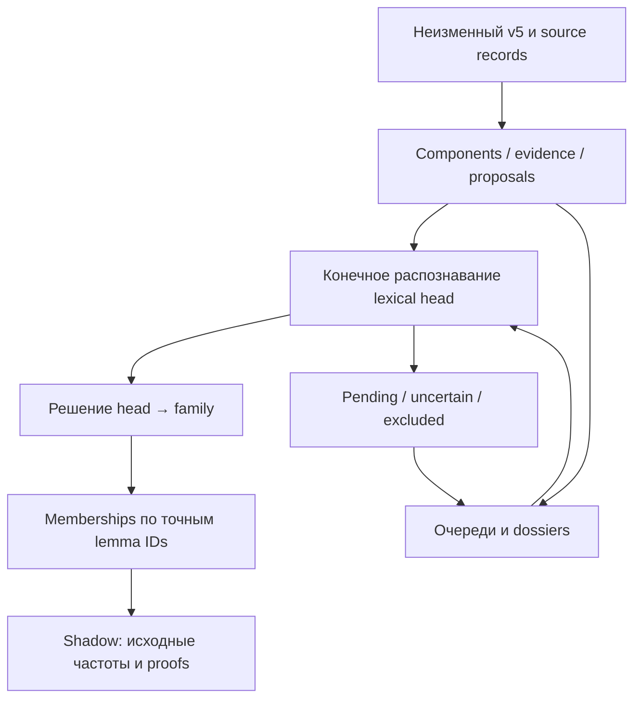

# Текущая архитектура associativvordes

Снимки **M** (main `39d8a47d`) и **V** (v6 `9fff7643`, дерево равно `1c04d9ae`) определены в [baseline](01-BASELINE-AUDIT.md). Пути V проверять через `git show`, а не искать их в main. Здесь описана существующая система; схема будущего external interchange ещё не утверждена.

## 1. Два отдельных контура

### Действующий M/v5

Рёбра схемы соответствуют M `scripts/build-associative-candidate-index.mjs` (offline entry point), `scripts/build-associative-static-search-index.mjs` (static entry point), `scripts/build-associative-exhaustive-family-index.mjs::buildFamilies`, `associativvordes/js/candidate-index-loader.js::createCandidateIndexLoader/loadCandidateEntries`, `family-index-loader.js::FamilyIndexLoader.candidateEntries`, `candidate-finder.js::findCandidatesForRoot`, `candidate-model-family.js::selectHighestFrequencyPerModel`, `association-analyzer.js::analyzeAssociativeWord/calculateLanguageScore/calculateFinalAssociation`. Static/legacy — fallback и поиск; прямого ребра к записи подтверждённого membership нет.

### Параллельный V/v6

V `scripts/build-associative-family-v6.mjs::bind/headId` переносит legacy exact proofs и конечные политики; `associative-family-v6-head-recognition.js::recognizeFiniteHeadBindings` проверяет заранее перечисленные связи; `associative-family-v6.js::applyHeadReview/generateV6Memberships` создаёт membership только из accepted edge и exact scope. V `scripts/lib/associative-v6-review-queues.mjs::regroupCurrentReviewQueues` и `associative-v6-queue-organization.mjs::organize` организуют вопросы. V `associative-family-v6-shadow.js::loadV6ShadowRuntime/searchCorpusRows` гидратирует измерения. Эти модули не подключены к production M.

## 2. Девять сущностей и фактическое разделение

| Сущность | M/v5: файл и структура/функция | V/v6: файл и структура/функция | Оценка |
|---|---|---|---|
| Поверхностная форма | `scripts/lib/associative-index-core.mjs::extractFrequencyRecords`: original/normalized/search_form; `morphology/normalizer.js::normalizeForMorphology` | `family-index-v6/schema.json::$defs.lemma`; immutable source locators | Есть. Search key не должен стать lexical ID |
| Лексема и значение | `scripts/lib/associative-family-graph.mjs::stableLemmaId(language, normalized)`; частоты агрегированы по написанию | `schema.json::$defs.head.sense`; `scripts/lib/associative-v6-senses-policy.mjs::decideLexicalRow` | Частично: смысл различается у головы, но corpus lemma не sense-resolved |
| Lexical head | `morphology/lexical-root-index.js::ROOTS/addRoot/getLexicalRootCandidates`: корневые предложения, а не словарные головы со значениями | `schema.json::$defs.head`; `build-associative-family-v6.mjs::headId`; `head-recognition.js::validateLexicalFacts` | Реализована в V, не создавать повторно. Legacy exact identity остаётся unresolved |
| Алломорф | `morphology/data/root-allomorphs.js::ROOT_ALLOMORPHS`, `morphology/analyzer.js::allomorphVariants` фильтрует language | `schema.json::$defs.reflex`; `associative-family-v6.js::REALIZATION_TYPES/validateRealizations/generalRealizations` | V разделяет общий reflex, branch stem, inflection, alias, historical form |
| Этимологическое свидетельство | `scripts/lib/associative-etymology-policy.mjs::RELATION_TYPE/templateRelations`; v5 family `etymon_keys/relation_evidence` | `schema.json::$defs.evidence`; `associative-family-v6.js::getEvidenceNode` внутри `loadParallelV6` | V `ety:*` — evidence cluster, не автоматически family |
| Словообразовательная связь | `morphology/analyzer.js::parseDerivationalModel/discoverLexicalComponents`; `TEMPLATE_RELATION_POLICY` | `schema.json::$defs.lemma_head_link.link_role`; finite bindings/component segmentation | Есть частные representations. Универсального source-neutral lexeme→lexeme relation нет |
| Ассоциативная семья | v5 family shard; `associative-family-registry.js::VERIFIED_ROOT_FAMILIES` — отдельный runtime fallback registry | `family-index-v6/catalog.json::families`, `associative-family-v6.js::validateCatalog` | V даёт явное canonical решение и typed family namespace |
| Подтверждённое членство | v5 member shard; `FamilyIndexLoader.candidateEntries` доверяет материализованным rows, учитывая статусы/ручное evidence | `schema.json::$defs.edge`, `generateV6Memberships`: accepted + exact links + correction verdicts | V явно отделяет решение от источника и поиска |
| Поисковый кандидат | `candidate-static-search.js::loadStaticCandidateEntries`; `candidate-finder.js::findCandidatesForRoot` | `associative-family-v6.js::stemProposal/routeQuery`, `head-recognition.js::proposeMorphologicalHeads` | V proposals имеют `establishes_membership=false` либо эквивалентные false-флаги |

В таблице сокращение `head-recognition.js` означает полный V путь `associativvordes/js/associative-family-v6-head-recognition.js`; остальные runtime-файлы без начального каталога находятся в `associativvordes/js/`.

## 3. Многозначность, омонимы и конкурирующие анализы

**Несколько морфологических анализов возможны уже в M.** `associativvordes/js/morphology/analyzer.js::parseDerivationalModel/assemble` сохраняет `best_analysis`, до четырёх `alternative_analyses`, confidence margin и fallback. `discoverLexicalComponents` отдельно возвращает components/alternatives. Это гипотезы сегментации, а не независимые лексемы.

**Полного разделения омонимов в корпусе нет.** M `stableLemmaId` учитывает язык и normalized spelling, не POS/sense; `candidate-finder.js::findCandidatesForRoot` дополнительно дедуплицирует по language + normalizedLemma. V `build-associative-family-v6.mjs::headId` учитывает язык, голову и sense discriminator, но V `recognizeFiniteHeadBindings` оставляет неоднозначной запись с несколькими binding facts на одну тройку language/family/lemma, вместо произвольного выбора. V `decideLexicalRow` откладывает конфликт историй без доказанного общего компонента.

**Несколько семей у одного corpus ID поддерживаются.** V `generateV6Memberships` ключует membership по language/family/lemma; `associative-family-v6-shadow.js::deduplicateV6CorpusRows` сохраняет несколько `accepted_memberships`, проверяя равенство измерений, а не суммируя их повторно. Это не даёт частот отдельных значений: `decideLexicalRow` возвращает `aggregate_only_not_sense_frequency`, `token_senses_established=false`.

**Конкурирующие свидетельства хранить можно, несколько текущих вердиктов одного edge — нет.** V `generateV6Memberships` отвергает дубликат head/family в `edgeMap`; `applyHeadReview` заменяет edge по версии. V `scripts/lib/associative-v6-head-lifecycle.mjs::lifecyclePredecessor/replayHeadLifecycle` сохраняет predecessor hashes, версии и ledger. Внешние противоречащие claims должны оставаться в отдельном observation-слое, прежде чем превращаться в один текущий reviewed edge.

## 4. Отрицательные решения и ручной приоритет

M `family-index-loader.js::BLOCKED_RUNTIME_STATUSES` блокирует `blocked_from_runtime`, `rejected`, `split_required`; `candidateEntries` исключает corpus_quality rejected и для curated family требует component evidence `manual_override`. Если разрешённый alias существует, но текущий язык не даёт rows, M `candidate-index-loader.js::loadCandidateEntries` возвращает `[]`, не проваливается в static search.

Но это не глобальная таблица запретов: при transport/parse ошибке `loadCandidateEntries` переходит к static/legacy; `annotateFamily` берёт `verified` из отдельного `associative-family-registry.js::VERIFIED_ROOT_FAMILIES`. Исторически удалённый membership не превращается автоматически в tombstone для каждого fallback. Малый synthetic probe в baseline подтверждает такой control flow; живой false revival не заявлен.

V `EDGE_STATUSES` использует `accepted/excluded/uncertain/pending`; это не тот же enum, что v5 `rejected/split_required`. V `generateV6Memberships` не создаёт membership для nonaccepted edge. V `scripts/lib/associative-v6-baseline-corrections.mjs::replayBaselineCorrections` удерживает current excluded/uncertain поверх исторических принятий. V `scripts/lib/associative-v6-queue-organization.mjs::organize` сохраняет historical occurrences, применяет current question verdict и не превращает grouping в linguistic decision.

Фактические guards применения V:

- `scripts/integrate-associative-v6-reviewed-stage.mjs`, top-level CLI: явные binding/accepted/excluded/uncertain flags, frozen queue hash, реальные language/root/lemma/word/status, проверка до `writeFile`.
- `scripts/lib/associative-v6-lexical-review.mjs::loadLexicalReview`: frozen binding/decision grants, проверка отозванного разрешения, immutable shard и record hashes.
- `scripts/lib/associative-v6-family-promotion.mjs::loadFamilyPromotions`: dossier hashes, exact source identity, explicit senses policy или точный замороженный historical compatibility grant. `validatePromotionDecision` сам по себе ещё допускает отсутствие senses policy; полный безопасный путь — loader с registry.
- `scripts/lib/associative-v6-head-lifecycle.mjs::replayHeadLifecycle`: private copy, predecessor/version, exact scope; новый link не наследует вердикт без собственного решения.

Это готовые полезные ограничения; будущий импортёр не должен обходить их прямым вызовом низкоуровневого materializer.

## 5. Подстроки, приблизительный поиск и объединение

M `root-matcher.js::fuzzyIncludesRoot` и `candidate-finder.js::isReliableFuzzyMorphemeAnalysis` всегда возвращают false. Формальные совпадения всё ещё используются в `exactRootMatchAtBoundary`, а `discoverLexicalComponents` допускает `surface_fallback`. Они не равны словарному доказательству.

M offline builder `scripts/build-associative-exhaustive-family-index.mjs::buildFamilies` группирует ограниченные nonproto etymon nodes по ключам, выделяет wide review, применяет exact seed claims; это не глобальный transitive union всех совпавших aliases. Вспомогательный `scripts/lib/associative-family-graph.mjs::FamilyGraph.addEdge/find` **содержит** union-find для `EQUIVALENT_BRANCH`, ограниченный типами evidence; в исследованном дереве его вызовы найдены в `tests/associative-family-production.test.mjs`, а не в текущем exhaustive builder. Поэтому неверны оба обобщения: «везде транзитивное объединение» и «механизма объединения вообще нет».

V `associative-family-v6.js::evidenceClusterSimilarity` выдаёт `review_only_no_merge`; `resolveV6Alias` возвращает несколько family IDs без объединения; `generateV6Memberships` требует accepted finite edge. `proposeMorphologicalHeads` может снимать регулярное окончание только ради предложения; это не binding и не canonical decision.

## 6. Что фактически участвует в ассоциативности

Проверен M, не гипотетическая схема внешних источников:

1. `frequency-loader.js::getFrequencyProfile` берёт исходные source IPM, категории/веса из `config-frequency-sources.js::LANGUAGE_SOURCES/BASE_CATEGORY_WEIGHTS`, сохраняет интервалы/cutoff/missing. Источники морфологии не являются частотными корпусами.
2. `candidate-model-family.js::lexicalModelDescriptor/selectHighestFrequencyPerModel` группирует по модели и выбирает представителя по F, затем rank/IPM/spelling для tie-break. Это отдельный шаг до ранжирования по P.
3. `association-analyzer.js::calculateAssociationScore` вычисляет `A=min(Di, .45Di+.35Pr+.20(100−Sh))` с clamp. Веса — `qwen-client.js::ASSOCIATION_SCORE_WEIGHTS`; semantic поля поступают из primary/review анализа относительно target meaning.
4. `association-analyzer.js::calculateFinalScore` вычисляет `P=100·(A/100)^.65·(F/100)^.35`; missing не приравнивается к zero. Веса — `qwen-client.js::FINAL_SCORE_WEIGHTS`.
5. `qwen-client.js::selectBestFinalModels/finalizeCandidateOrdering`, `script.js::scoringCandidates` и `associative-state.js::MAX_ASSOCIATIVE_MODELS_PER_LANGUAGE` ограничивают выбор пятью моделями по итоговому весу. `calculateLanguageScore` берёт max P и A его представителя; это не среднее A всех слов.
6. `association-analyzer.js::calculateFinalAssociation` и `shared/control-language-demographics.mjs::calculateDirectDemographicAverage` взвешивают языковые результаты по N; действуют пороги 35%, ≥3 языка, ≥2 группы, completeness/review gates.
7. `association-analyzer.js::calculateSwowBonus/analyzeAssociativeWord` сохраняет SWOW как диагностику, бонус равен 0. Наличие морфологического edge не заменяет semantic A и не даёт SWOW-бонус.

Проверенные индексы и семьи влияют на набор кандидатов и модель; source morphology confidence сейчас не входит отдельным множителем в F/A/P. Менять это интеграцией без отдельного методологического решения нельзя.

## 7. Точки разрыва для external data

M `candidate-finder.js::findCandidatesForRoot` создаёт новый candidate object, не передавая `lemma_id`, head ID, `components`, `source_proof`; дедупликация spelling стирает альтернативные источники. V shadow сохраняет измерения и memberships, но ещё не соединён с этим page adapter. Нужен будущий контракт адаптера, сохраняющий identity/provenance и текущие формулы, а не повторная реализация v6.

V `family-index-v6/schema.json::$defs` — набор сущностей v6, не универсальная external relation schema. В нём нет полного source/version/license/dependency registry для UDer/GLeMM/MorphyNet/Flexor. M `scripts/lib/associative-etymology-policy.mjs::TEMPLATE_RELATION_POLICY.uder` — **Wiktionary template name**, не готовый импортёр Universal Derivations. Смешивать эти значения особенно опасно.
